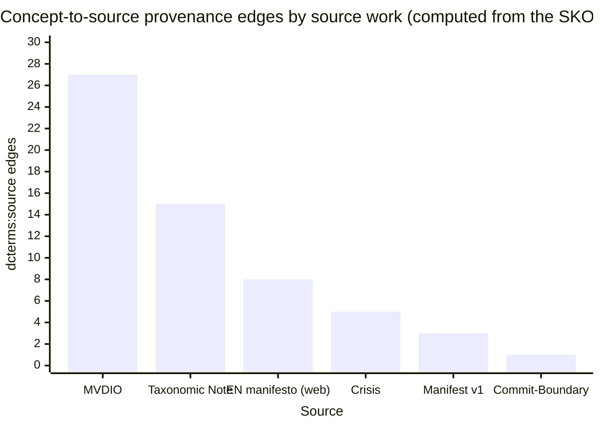
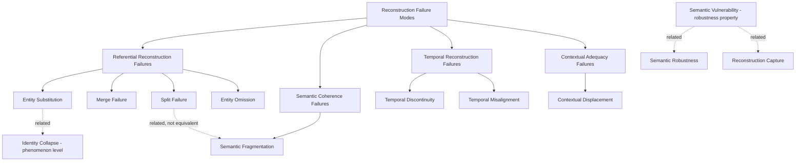

\begin{center}
{\LARGE DIO/ODI Applied to Itself: The Resilience of a Distributed Scholarly Identity\par}
\vspace{0.8em}
{\large\itshape Author-Led Research Using Mistral\par}
\vspace{0.8em}
{\large Daniel Beránek\par}
\vspace{0.3em}
Independent Researcher, Brno, Czech Republic\par
dan@danielberanek.cz\par
\vspace{0.5em}
October 30, 2026\par
\end{center}

# DIO/ODI Applied to Itself: The Resilience of a Distributed Scholarly Identity

**Research question.** *At the observed point in time, to what extent does the distributed DIO/ODI ecosystem sustain a recognizable, referentially continuous, and meaningfully reconstructable identity across heterogeneous representations and entry points — despite partial inconsistencies, gaps, inaccessible resources, and uneven updating?*

**Scope statement.** This is a reflexive analysis: the DIO/ODI framework is examined through its own conceptual vocabulary, at a temporal snapshot (29–30 October 2026). DIO (Digital Identity Optimization) is treated as an ongoing optimization process, not a permanently achieved state, and the ecosystem under study is one observation of that process — not a finished product. The question is not whether defects exist; a distributed, multi-platform, unevenly updated corpus of this kind necessarily exhibits them. The question is whether the identity holds together despite them, and at what levels of reconstruction detail the holding and the straining occur. Two methodological commitments follow. First, **interpretive symmetry**: safeguards are not treated as proof of protection, and defects are not treated as proof of failure — each observed condition is assessed for what it does to specific reconstruction tasks, not for what it symbolizes. Second, **level discipline**: every finding is stated at its proper level — **(a)** the observed artifact or condition, **(b)** its architectural role within DIO/ODI, **(c)** its local consequence for reconstruction, **(d)** its system-level significance — and no conclusion silently jumps from (a) to (d).

---

## 1. Method and Evidence Base

### 1.1 Corpus of inspected artifacts

The analysis rests on direct inspection of the following layers of the ecosystem:

- **The archival/scholarly layer:** Zenodo records for the eight works of the corpus (Manifest v1, Conceptual Framework v1 and v1.1.0, Crisis v1.0.0 and v1.1.0, MVDIO, Taxonomic Note, Commit-Boundary paper) and their concept DOIs, the arXiv mirror of the Commit-Boundary paper, and the seven Reference Model release records aggregated under the Vocabulary Concept DOI.
- **The machine-readable layer:** the canonical SKOS vocabulary in Turtle form, parsed directly; the metadata registries (works, relations, distributions, keywords) and their README; the repository's documentation (terminology, source map), application mappings, llms.txt, and CITATION.cff.
- **The live web layer:** the hub at `/manifest-dio/`; **all sixteen language versions** of the manifesto (Czech, English, and the fourteen projections: German, French, Spanish, Italian, Portuguese, Polish, Finnish, Hungarian, Ukrainian, Chinese, Japanese, Korean, Arabic, Hindi); the professional bio page; the DIO service page; the site llms.txt, llms-full.txt, and sitemap.xml.
- **The identity layer:** the ORCID record (0009-0004-0050-0264), the ResearchGate profile, and the person-level linkage artifacts (person URI, `sameAs` assertions).
- **The external distribution layer:** the mirror DOIs documented on the hub (SSRN, Figshare, ResearchGate entries), as recorded in the distribution registry and the hub's citation helper.

Retrieval limits encountered during inspection: Zenodo's search interface and API blocked automated access (individual record pages remained accessible); the ORCID record page displayed a sandbox-style banner, treated as a retrieval artifact and cross-validated through the works registry; text extraction could not verify HTML-level language-alternate declarations (hreflang) and left the Arabic page's K6 line formatting ambiguous (right-to-left extraction). These limits are carried into the findings below wherever they bound a claim.

### 1.2 Levels of reconstruction detail

"Reconstructability" is not a single property. An observer arriving at the ecosystem may be attempting any of five progressively more demanding reconstructions, and a condition that strains one level may leave another untouched. The levels used throughout this report:

- **D1 — Referent identification:** that a single framework, authored by a single identifiable person, is what all these representations are about.
- **D2 — Conceptual core:** the central distinctions — the DIO/ODI split (applied discipline vs. theoretical meta-layer), the six-dimension K6 terminology, the Reconstruction Failure Mode taxonomy, the robustness vocabulary.
- **D3 — Structural semantics of core relations:** *how* the central relations are structured — most importantly, whether the K6 invariant is a simultaneous, non-sequential field or a sequential process.
- **D4 — Version state and currency:** which representation state of a work is current, and which are superseded.
- **D5 — Provenance, genesis, and full distribution:** where conceptual statements come from, how the corpus developed, and how it is distributed across platforms and languages.

### 1.3 Variation taxonomy

Observed differences between representations are classified before being evaluated, because the classification does most of the interpretive work:

1. **Identity-preserving variation** — differences in register, medium, or detail that leave the referent and the conceptual core intact (e.g., the scholarly Zenodo abstract vs. the strategic-communication service page describing the same framework).
2. **Documented development** — differences that *are* the framework's history, declared as such by dated changelogs, version records, and retained superseded states.
3. **Version misalignment** — a representation that presents a superseded state as if current, with a corrective pathway available (inspectable or not).
4. **Incompatible current claims** — representations that assert structurally different current semantics of the same relation, with no internal marker distinguishing them.
5. **Susceptibility** — a structural condition that would *allow* a reconstruction failure in some observer, whether or not any failure has occurred.
6. **Observed failure** — a completed reconstruction failure in a downstream observer, witnessed as such.

The distinction between 5 and 6 is enforced throughout: concentrations create susceptibility; they do not realize outcomes. The distinction between 3 and 4 decides most of the substantive questions below.

### 1.4 Materiality criteria

A weakness is assessed not by counting defects but by asking: which reconstruction task (D1–D5) and which class of observer does it affect; does it obscure the referent or alter a central conceptual relation; is compensation **inspectable** (a corrective representation was actually found on an inspected pathway) or merely assumed; and does the condition propagate across layers or stay locally contained. Symmetrically, a safeguard is assessed by which reconstruction task it supports, at which level, for which observer — not by its mere presence.

---

## 2. The Ecosystem and Its Architecture

### 2.1 The corpus and its genesis

The DIO/ODI corpus developed between March and October 2026, and its development is reconstructable from at least three independent representations that agree with one another: the hub's dated changelog, the relations registry, and the papers' own citation networks. In outline: the Manifest (Zenodo, July 2026) states the applied DIO doctrine and the K6 invariant; the Conceptual Framework (August, revised to v1.1.0 in October) develops the theoretical ODI layer; the Crisis paper (September, revised v1.1.0) addresses identity under adverse conditions; MVDIO (October) specifies the machine-verifiable operationalization; the Taxonomic Note (October) refines the failure-mode taxonomy; the Commit-Boundary paper (October, also on arXiv) addresses change management at the publication boundary; and the Reference Model — released in versions from 0.1.0 to 0.5.0, with the vocabulary under its own Concept DOI — consolidates the machine-readable layer.

### 2.2 The five layers and their architectural roles

**(a) The archival layer** — the Zenodo records and their concept DOIs. Its architectural role within DIO/ODI is to be the durable, versioned state of the framework: the layer that certifies what was claimed, when. Superseded records are retained rather than overwritten, and record pages display "newer version available" banners (observed on the Conceptual Framework v1 record). The registry states the governing principle verbatim: corrections must not imply "that the earlier metadata state never existed" ([metadata README](https://raw.githubusercontent.com/dan-beranek/dio-odi-reference-model/main/metadata/README.md)).

**(b) The machine-readable layer** — the canonical SKOS vocabulary (40 concepts bound to a stable namespace), the metadata registries (works, relations, distributions, keywords), the documentation and application mappings, and the llms.txt files. Its role is reconciliation: this is the only layer where *concepts* bind to *publications* (via `dcterms:source` edges), where relations are *typed* rather than implied, and where the current semantics of contested relations are stated explicitly.

**(c) The live web layer** — the hub and the sixteen language versions of the manifesto, plus the professional bio and service pages. Its role is articulation and genesis legibility: the hub links everything to everything else and documents the framework's development in a dated changelog. It is simultaneously the layer most exposed to uneven updating, as Section 5 shows.

**(d) The identity layer** — the person URI in the works registry, the ORCID iD, the `sameAs` assertions in the mappings' JSON-LD, and the ResearchGate profile. Its role is entity-level anti-substitution: keeping "Daniel Beránek, independent researcher" and the author's commercial professional identity recognizably the same referent across registers.

**(e) The external distribution layer** — SSRN, Figshare, ResearchGate, and (linked from the hub but not inspected here) HuggingFace and Kaggle. Its role is reach; its characteristic condition is platform-relative state (mirrors, duplicates, lag) that the distribution registry types and audits.

The layers are not synchronized, and are not designed to be. They carry different relations, at different granularities, for different observers — human clients, machine crawlers, scholarly platforms. The architecture's bet, stated in DIO's own terms, is that identity survives **identity-preserving variation across observation domains**; the empirical question is whether the observed corpus keeps its variations inside that category.

---

## 3. The Ecosystem as a Graph: Structure and Observation Boundary

### 3.1 Model and boundary

The ecosystem was modeled as a heterogeneous directed graph: nodes = works (8), Zenodo records and concept DOIs (18), external distribution DOIs (15), web pages including the 16 language manifests (25), machine-layer artifacts (13), identity records (10), external scholarly sources (5) — **92 nodes, 255 observed edges**. Edge types include hyperlinks, typed citation/derivation relations, semantic relations (SKOS), version/provenance relations, authorship and identity assertions, distribution relations, and documentation relations.

**Observation boundary (applies to every numerical statement in this section):** edges are those witnessed in the collected corpus at the snapshot (29–30 October 2026); external-literature clusters are collapsed; in-degree means in-corpus in-degree; and **reachability is computed over collected directed edges only** — it does not model search-mediated discovery, DOI-resolver behavior, social discovery, or page regions not captured by extraction. The conceptual graph (the SKOS vocabulary) is analyzed separately from this infrastructural graph; the two are never merged in a single computation.

### 3.2 Principal computed findings

- **The hub is the ecosystem's articulation point.** In-degree 26 (highest), out-degree 53 (by far the highest), betweenness ≈ 2,531 — approximately 4.4× the next node, the vocabulary (573). In DIO's own terms, this is a structurally concentrated topology that creates **susceptibility to Reconstruction Capture** and a **structural dependency** on the hub. It is not, on the observed evidence, a realized capture: no downstream reconstruction — correct or captured — was observed at all. The distinction matters because the two conditions call for different responses: the first is a property of the topology that any observer inherits; the second would be an event in an observer, which the snapshot cannot witness.
- **The Manifest v1 record is the genealogical root.** In-degree 14, out-degree 0 — the most-referenced artifact in the corpus, referenced by everything it generated and referencing nothing downstream. An observer entering anywhere in the archival layer is structurally routed toward the origin, which supports D5 (genesis) reconstruction from any paper.
- **The vocabulary is the second center, of a different kind.** In 9 / out 18; and the Vocabulary Concept DOI (23272897) — in 3 / out 18 — functions as the version aggregator and carries the only observed typed link (`isDocumentedBy`) from the archival layer to the hub, present on Reference Model/vocabulary records since 10 October 2026. Within the collected edge set, this is the sole observed typed bridge from the archival layer back to the living framework; the qualification "within the collected edge set" is part of the finding, not a hedge — search-mediated and resolver-mediated routes exist and were not measured by this method.
- **Papers alone do not reach the living ecosystem.** From the ten inspected paper/version records alone (excluding the Reference Model records), directed traversal over collected edges reaches 18 of ~93 nodes: a self-contained theoretical genealogy, but no collected edge leads from any paper record to the hub. For link-following machine observers entering from a citation of an individual paper, this is a **missing connection in one traversal class** — bounded by the edge set; it says nothing about observers who arrive by search, by ORCID, or by human navigation.
- **The ORCID record is an identity fan-out with minimal reciprocity.** In 2 / out 20: the identity layer reaches outward everywhere and is reached from almost nowhere within the corpus. This asymmetry is architecturally coherent — identity records are designed as roots for traversal, not destinations — but it means the identity layer cannot serve as a convergence point for in-corpus navigation.

### 3.3 The conceptual graph

Parsed directly from the canonical SKOS file: **40 concepts, 47 `skos:related` assertions, 18 hierarchy edges (12 taxonomic + 6 K6 `hasPart`), and 59 `dcterms:source` provenance edges**. Highest related-degree: ReconstructionMechanism (10), MVDIO (7), ReferentialContinuity (7). The provenance edges bind concepts to their documentary bases with the following computed distribution:

This is the only quantitative statement in the report made about the conceptual layer as such, and it is the layer's core function: a machine can reconcile any of the 40 concepts with its documentary basis without re-reading the corpus.

### 3.4 The analytical vocabulary

The report's descriptive vocabulary is the framework's own, published in the repository's concept map:

The taxonomy is used below with its own discipline: a *failure mode* is an event in an observer; a *vulnerability* is a structural property. Observed conditions in the corpus are classified as susceptibilities, misalignments, or — only where actually witnessed — failures.

---

## 4. What Holds the Identity Together: Eight Reconstruction Mechanisms

The following mechanisms are all directly observed in the artifacts. Each is stated with the reconstruction levels it supports, and with the distinction between **documented design** (the artifact declares its function) and **observed effect** (a reconstruction was actually seen to be supported). Where the function is designed and the effect unobserved, this is stated.

**M1 — Identifier continuity infrastructure.** Concept DOIs group version records (Manifest 21610933 -> 21610934; Crisis 22257503 -> 22257504/22416026; Reference Vocabulary 23272897 -> seven Reference Model releases), superseded records are retained, and record pages route observers forward ("newer version available" banners, observed on [21839423](https://zenodo.org/records/21839423)). Within DIO, this implements identity-preserving change with explicit provenance. *Supports: D4 (version state) and D1 (referent continuity across change). The routing function is platform-documented design; its downstream effect on real observers is unobserved.*

**M2 — Concept-to-document provenance binding.** The 59 `dcterms:source` edges (§3.3) bind every concept in the vocabulary to specific DOIs. This is the only layer where concepts, not documents, are the units of reference. *Supports: D5 (provenance) at machine level, and D2 (conceptual core) by making conceptual claims checkable against their bases.*

**M3 — A current definitional arbiter.** The vocabulary is positioned as the semantic layer above the corpus, and it adjudicates: it declares K6 non-sequential ("The vocabulary does **not** model these as a sequential pipeline" — [terminology.md](https://raw.githubusercontent.com/dan-beranek/dio-odi-reference-model/main/docs/terminology.md)); it demotes *Entity Resolution Anomaly* to a historical label with an instruction not to reconstruct the hierarchy through it; it keeps *Identity Collapse* deliberately outside the failure taxonomy; and it retains the singular *Identity-Preserving Constraint* as a historical entry with "no semantic relation … asserted" to the current plural term. *Supports: D3 (structural semantics) above all — this is the representation a reconstruction should converge to when others disagree, and it is machine-readable, versioned, and archived.*

**M4 — A lexical identity invariant.** The keyword grammar ([keywords.json](https://raw.githubusercontent.com/dan-beranek/dio-odi-reference-model/main/metadata/keywords.json)) fixes an ordered grammar — C0 identity invariant first, always; C1 environments second; aliases "for reconstruction, not export" — so that records remain mutually recognizable by machines across platforms even when their prose differs. *Supports: D1 and D2 for machine observers. The recognition function is documented design; downstream recognition effects are not observed.*

**M5 — Genre and context declarations for observers.** The llms.txt files partition evidential genres (`evidence-distinction`, `research-distinction` separating biography, client references, case studies, and research provenance — [site llms.txt](https://danielberanek.cz/llms.txt)); the hub carries a dated changelog and AI-disclosure statements; the ResearchGate Reference-Model entry carries an explicit "distribution pointer only … Do not treat this page as a separate publication or mint a separate DOI" note; mapping documents carry scope disclaimers ("not part of the canonical … Vocabulary"). Within DIO, these can be interpreted as context-adequacy scaffolding: designed to prevent a legitimate aspect of the author's identity (commercial, scholarly, platform) from displacing the aspect relevant to a given observational situation. *Supports: D1 for observers encountering mixed-register representations.*

**M6 — Redundancy with typed, self-correcting relations.** Works are distributed across up to five platforms, and the distribution registry types each relation explicitly — including documented corrections of Zenodo's observed `isSupplementedBy` to author-verified `isIdenticalTo`/`isVersionOf`, with per-version relation history ([distributions.json](https://raw.githubusercontent.com/dan-beranek/dio-odi-reference-model/main/metadata/distributions.json)). Compensation here is **inspectable, not assumed**: the registry records the verification basis for each typed relation, and the audit queue declares which works remain unaudited. *Supports: D4 and D5 across the distribution layer — the layer most prone to platform noise.*

**M7 — The hub as articulation point with genesis legibility.** The hub ([/manifest-dio/](https://danielberanek.cz/manifest-dio/)) links all sixteen language versions, all publication DOIs, the vocabulary, the repository, the mappings, and the distribution layers, and documents the framework's genesis in a dated changelog (25 March – 25 October 2026). This makes development reconstructable in a way no single paper supports. It is simultaneously the principal structural dependency of the system (§5, W5) — the mechanism and the vulnerability are the same node. *Supports: D5 comprehensively, and D3 via its routing to the vocabulary and to the Czech "interpretive reference" manifesto.*

**M8 — Author-identity linkage.** The person is bound across layers by a stable person URI in the works registry, `sameAs` assertions in the mappings' JSON-LD, the ORCID iD on the vocabulary footer and CITATION.cff, and ORCID's links to the website, GitHub, ResearchGate, HuggingFace, and Kaggle. Within DIO, this is entity-level anti-substitution infrastructure, designed to keep the commercial and scholarly person-recognitions from splitting into two referents. The fusion is deliberate identity-preserving merging; the risk it carries — that a scholarly-context observer acquires commercial-register context — is assessed in W3/W8 below. *Supports: D1 at the person level.*

**What the mechanisms jointly provide.** Read together, the eight mechanisms cover the five reconstruction levels with different mechanisms doing different work: M1/M6 carry version discipline (D4), M2 carries provenance (D5), M3 carries structural semantics (D3), M4/M5/M8 carry recognition across registers (D1/D2), M7 carries genesis and articulation (D5). No single mechanism is redundant with another, and — with the partial exception of M7 — each has an inspectable failure-adjacent counterpart elsewhere in the system. This is the architecture's answer to the research question in miniature: identity is not held by synchronization but by **typed redundancy with declared gaps and retained history**.

---

## 5. Conditions That Strain Reconstruction: A Materiality Assessment

Eight principal conditions were observed. Each is stated at the four levels: the observed condition (a), the reconstruction task and observer affected (b/c), the effect on referent and conceptual relation, the compensation actually found, and the propagation verdict (d). "Compensation inspectable" means a corrective representation was found on an inspected pathway — not that all observers will traverse it.

**W1 — Language-version divergence in the K6 invariant.** All sixteen language versions were inspected directly. The Czech and English versions carry the current formulation: K6 presented as a simultaneous, non-sequential field ("·" separators, explicit anti-linear doctrine). The other fourteen pages carry the earlier "dynamic process" framing; thirteen of them (German, French, Chinese, Spanish, Italian, Portuguese, Polish, Finnish, Hungarian, Ukrainian, Japanese, Korean, Hindi) display the invariant as a linear arrow chain ("entity -> representation -> …"); the Arabic page shows the process framing, with the chain not detected in text extraction (an extraction limit, not a confirmed absence). All fourteen self-present as "living documents." *(a->b/c)* This affects **D3 — the structural interpretation of one central model** — for observers entering through a non-CZ/EN page, above all machine samplers that read a single page without traversal. *(Referent)* The referent is retained: same six dimensions, same terms, same work, one archive; indeed the archived Zenodo edition of the manifest contains the v1 invariant, so the fourteen pages are faithful projections of the canonical archive — the divergence is between the *live CZ/EN* pages and everything else. What is altered is one central conceptual relation **in representation**: process/cycle versus simultaneous field. *(Compensation)* Inspectable but unmarked: the hub links the Czech page as "interpretive reference," and the vocabulary states the non-pipeline semantics; both are two hops from any language page, and the v1 pages carry **no supersession marker** — their "living document" self-presentation actively removes the cue that they preserve an earlier state. *(d)* Contained with a real strain: the divergence does not propagate to other layers, and in the taxonomy of §1.3 it sits between *version misalignment* and *incompatible current claims* — misalignment because a correct current statement exists and is reachable; incompatible because nothing on the conflicting pages themselves distinguishes them. It is materially significant for single-page machine observers and for the framework's own stated invariant; it is not framework-defining, because terminology, referent, and archive are intact. It is the clearest candidate for identity-preserving variation drifting toward fragmentation if current-only content keeps accruing on CZ/EN.

**W2 — ORCID version-state misalignment.** The ORCID work list is dominated by mirror DOIs (SSRN, Figshare via Crossref) and includes the superseded v1 of the Conceptual Framework (21839423), not the current v1.1.0. *(b/c)* Affects **D4 — version state of one work** — for ORCID-entry observers and aggregators resolving authorship from ORCID; D1–D3 are unaffected. *(Referent)* Retained; this is the framework's own definition of **Temporal Misalignment**, instantiated as a representational condition — the theory describes its corpus with unusual precision. *(Compensation)* Inspectable, one hop: the v1 record displays a "newer version" banner; the registry records the current version DOI. *(d)* Contained: a *potential obstacle* to one work's version reconstruction. A wrong reconstruction actually produced by a downstream observer was not observed and is not claimed.

**W3 — ResearchGate duplication.** The profile lists 17 publications with visibly duplicated entries (Commit-Boundary and Conceptual Framework each appear twice) within one profile. *(b/c)* Affects work-count and profile-level reconstruction for RG-entry observers and citation analysts; creates **susceptibility to double counting or split reconstruction** at the platform layer. *(Referent)* Retained; the duplication is a platform display condition, not a claim about the works. *(Compensation)* Partially inspectable: the hub's citation helper and the RG "distribution pointer" note on the Reference Model entry give guidance, but the duplicates themselves carry no internal markers. *(d)* Contained at the platform layer — in DIO terms, a susceptibility to Merge/Split confusion whose realization in downstream reconstruction is unobserved.

**W4 — Registry–hub distribution lag.** The hub documents external distribution DOIs for Crisis, Taxonomic Note, and Commit-Boundary that the distribution registry does not yet record; the registry's own audit queue lists these works as unaudited. *(b/c)* Affects machine consumers of the operational registry, who would miss mirror-distribution data for three works. *(Referent)* None altered; a **declared completeness gap** in the layer that claims to be the operational source of truth. *(Compensation)* Inspectable and declared on both sides: the audit queue acknowledges the gap; the hub and ORCID carry the missing facts. *(d)* Contained: a flagged gap, not a silent inconsistency. The registry's completeness claim is temporarily ahead of its content — a strain on efficiency, not on identity.

**W5 — Hub concentration.** The graph findings of §3.2 quantify it: in-degree 26, out-degree 53, betweenness ≈ 2,531 (~4.4× the next node). *(b/c)* Affects any observer whose route depends on hub traversal — machine crawlers following links, humans navigating from the site — for **D3, D4 (current semantics), and D5 (genesis, language versions, distribution layers)**. *(Referent)* No referent or relation altered: this is a **structural dependency**, not a defect of any representation. *(Compensation)* Not compensable by design for its own failure: hub unavailability would cut hub-routed access to current semantics, the genesis changelog, the sixteen language pages, and the HF/Kaggle layers. *(d)* System-level susceptibility with a **bounded failure mode**: on the inspected evidence, loss of the hub would degrade reconstruction to the archived and vocabulary layers — a coherent corpus and concept system in their archived states, current through October 2026, minus the living layer — rather than destroying identity. This degradation mode is **inferred from the edge structure, not observed**; behavior under actual hub unavailability was not tested. In DIO terms, the hub is the ecosystem's principal **Semantic Vulnerability**, and its concentration creates susceptibility to Reconstruction Capture; realized capture is unobserved. The vulnerability compounds with W1: the same node that routes the correction for the language divergence is the single point of concentration. The two strains are not independent.

**W6 — Archival->web link gap.** Within the collected edge set (255 observed edges), no directed edge leads from any of the ten inspected paper/version records to the hub; the `isDocumentedBy` link exists only on Reference Model/vocabulary records (since 10 October 2026). *(b/c)* Affects link-following machine observers entering from citations of individual papers, who recover a self-contained theoretical genealogy (18 of ~93 nodes) but not the living ecosystem. *(Referent)* No alteration; a **missing connection in one traversal class**. *(Compensation)* Inspectable alternative routes exist: paper -> concept DOI -> Reference Model record -> hub, and (for humans) search and the ORCID->website path. *(d)* Contained to link-based traversal. The claim is bounded by the observed edge set: it does not describe search-mediated or social discovery, which this method does not measure.

**W7 — K6 provenance to a mutable page.** The six K6 dimension concepts cite the living English web manifesto as `dcterms:source`; three of the six also cite the MVDIO DOI; the archived Zenodo manifest contains the v1 invariant. *(b/c)* Affects provenance resolution for six concepts: a future historian of the vocabulary would need a mutable web page to verify the dimensions' current formulation. *(Referent)* Concept **content recoverable from archived sources**; only the provenance *pointer* is unstable. *(Compensation)* Inspectable: MVDIO covers three dimensions; the vocabulary's own definition carries the semantics independently. *(d)* Contained: a future-proofing strain, not a current reconstruction obstacle.

**W8 — Minor conditions.** One Zenodo record (Commit-Boundary) lists the business as affiliation where others list "Independent Researcher"; three category concepts lack `skos:definition`; one scope note references "v0.1" inside the v0.2.0 file; the Chinese, Japanese, and Korean pages are the shortest inspected (~13–17k vs. ~27–29k characters for the European versions). *(b/c)* Contextual and detail-level effects; detail reduction only. *(Referent)* No obscured referents; no altered central relations. *(Compensation)* All contextualizable from the registry, the papers, or the CZ/EN versions. *(d)* Contained; low materiality. The affiliation item is a small contextual-displacement susceptibility at the metadata level — a scholarly-context observer may acquire commercial-register context — mitigated by the genre declarations of M5.

**Materiality summary.** No observed condition obscures the framework's referent (D1 holds everywhere). One condition (W1) alters the *representation* of a central conceptual relation (D3) while retaining its terminology, archive, and corrective pathway. One condition (W5) is a system-level structural dependency (D3/D4/D5 for hub-routed observers) with a bounded, degradation-not-destruction failure mode. The remainder reduce detail, create version-state misalignment (D4) at third-party platforms, or declare their own incompleteness. The most consequential *combination* is W1 + W5: the hub is both the articulation point that holds the language star together and the only component that currently routes to the current semantics — so version divergence and hub dependency compound for any observer outside the hub's reach. Every other condition is locally contained, with compensation actually found on inspected pathways.

---

## 6. Entry-Point Analysis

Three entry points were inspected directly. "Recoverable" means directly present, or present on a pathway actually traversed during this research. Acquisition failures are observer-relative throughout: an entry point that fails one observer class may serve another.

| Dimension | **A. Zenodo corpus** (papers + concept DOIs + RM records) | **B. Web hub** `/manifest-dio/` | **C. ORCID record** |
|---|---|---|---|
| D1–D2: framework identity (DIO/ODI distinction, K6 terms, failure taxonomy) | Recoverable — abstracts, descriptions, RM records' reference lists | Recoverable — manifest pages, vocabulary links, changelog | Partially — keywords and work titles name DIO/ODI; structure must be reached via the linked website |
| D3–D4: version state and current semantics acquired | Current for each work via concept DOIs + "newer version" banners; mixed keyword styles on older records (historical layering, contextualizable via the keyword grammar) | Current overall — including the simultaneous-field K6 semantics (CZ/EN) alongside the 14 earlier-framing pages | Partially outdated — mirror DOIs and the superseded v1 of the Conceptual Framework; corrective banner one hop away |
| Register | Scholarly, deflated claims | Mixed: strategic-communication register on service pages, scholarly on manifest pages; hub itself in Czech | Scholarly-platform, with commercial affiliation and pre-DIO theses (2005–2011) attached to the same identity |
| Corrective pathways found (inspectable) | Newer-version banners; concept DOI -> RM record -> hub (`isDocumentedBy`) | Hub -> vocabulary (current definitions); hub -> CZ "interpretive reference" + EN current version | ORCID -> website (`sameAs`) -> root -> hub; ORCID -> DOI -> record banner |
| Principal blind spot | Genesis narrative, current K6 semantics, language versions, mappings — all cut off without the Reference Model layer | Older record versions require traversal via hub DOI lists; machine-level language alternates unverifiable (extraction limit) | Framework structure as such; the newest works appear via mirrors, not canonical records |
| Reconstruction produced | A coherent, genealogically complete, version-correctable **theoretical corpus** | The full **living ecosystem**, including its commercial self-presentation and genesis | An **author identity** that is recognizable but versionally lagging for one work |

**Interpretation.** The three entries produce reconstructions that **converge on D1–D2 and diverge on D3–D5**: referent and conceptual core are recovered from every entry; structural semantics and version state depend on which entry an observer uses, and how far they traverse. This is precisely the pattern DIO's own vocabulary calls identity-preserving variation across observation domains — the entries differ as observation contexts, not as rival referents. In every entry, at least one route toward the current definitional state was actually found; in none of them is that route automatic, and in none is it marked on the first artifact an observer touches. The strongest reconstruction combines A and B: the archival entry supplies typed provenance and version discipline; the web entry supplies current semantics and genesis. The vocabulary and its Concept DOI (23272897) are what make the combination cheap — they are reachable from both sides and carry the concept-level reconciliation. An observer who enters via ORCID alone obtains a recognizable but versionally lagging author identity; whether that lag ever produces a wrong reconstruction in practice is a susceptibility, not an observed event.

---

## 7. Synthesis

### 7.1 What appears to hold together

- **The referent chain (D1).** Author -> person URI -> ORCID -> works -> concept DOIs -> stable concept URIs is continuous and typed on every inspected pathway. Nothing observed anywhere in the corpus obscures *what* the framework is or *who* authored it. This is the report's most robust finding, and it survives every weakness in Section 5.
- **The conceptual core (D2).** The identity-carrying distinctions — the applied/theoretical split, the six dimensions, the failure taxonomy, the robustness vocabulary — are stated consistently in the vocabulary, the papers, the CZ/EN manifestos, the mappings, and the keyword grammar.
- **The structural semantics of the core (D3), arbitrated.** The one real cross-representation conflict in the corpus — the K6 linearity question — has a current, archived, machine-readable statement (M3) that is reachable from the conflict site. This is what keeps the inconsistencies in W1 at the level of *version misalignment with an inspectable corrective* rather than *incompatible current claims with none*: the ecosystem's authoritative representations agree; the disagreement lives in superseded-but-unmarked peripheral pages and in third-party platform states.
- **The corpus genealogy (D5).** The development from Manifest (July) to Commit-Boundary (October) is reconstructable from at least three independent representations — changelog, relations registry, papers' own citations — that agree with one another.
- **The change discipline.** Superseded states are retained and marked: banners, history notes, audit queues, per-version relation history. Within DIO's own terms, the ecosystem implements identity-preserving change rather than erasure — the strongest single source of its apparent resilience.

### 7.2 Where continuity is strained

- **The fourteen earlier-framing language pages (D3)** are the clearest strain: they present the framework's most reproduced artifact in a superseded structural form, self-present as "living documents," and carry no supersession marker. The correction exists but sits two hops away, and the pages' own text gives no signal that it is needed.
- **Platform version-state lag (D4)** at ORCID and ResearchGate — contained, but it is exactly the class of condition the framework's theory predicts will produce misalignment for *some* observers in *some* domains. Which observers, and how many, cannot be determined from the snapshot.
- **The hub dependency (D3–D5 for hub-routed observers)** — the system's principal structural susceptibility, compounded by the language divergence: the same node that routes the correction is the single point of concentration.
- **The registry's completeness claim** temporarily exceeds its content for three works — declared, and therefore a strain on efficiency rather than on identity.

### 7.3 What cannot be determined from the observed snapshot

- Whether any external observer has reconstructed the framework at all. Within the search limits (web and news corpora, at snapshot), no independently documented reception was found; this is an **absence of evidence within those limits**, not evidence that no external reconstruction exists.
- Whether AI systems actually consume the llms.txt files or the SKOS vocabulary, and with what effect. The mechanisms' functions are documented design; their downstream effects are unobserved.
- Whether the unmarked status of the earlier-framing pages produces wrong reconstructions in practice. The susceptibility is demonstrated; the outcome is not, because the outcome would occur in observers, and none was observed.
- The outcome of the deliberately withheld `isIdenticalTo` review between the Reference Model and the namespace URI.
- Machine-level language alternates (hreflang): the text-extraction method cannot verify HTML declarations.
- The targets of ResearchGate's 13 reported citations.
- Actual behavior under hub unavailability: the degradation mode is inferred from the edge structure, not observed.

### 7.4 Verdict

**To a substantial extent — yes: at the observed snapshot, the distributed DIO/ODI ecosystem sustains a recognizable, referentially continuous, and meaningfully reconstructable identity, with specific locally contained strains and a small set of structural susceptibilities that constrain but do not defeat reconstruction.**

The judgment distributes across the levels of reconstruction detail: D1 and D2 hold from every inspected entry point without exception; D3 holds through an explicit reconciliation layer, strained at the periphery (W1) but arbitrated at the center (M3); D4 holds in the archival and machine-readable layers and lags in third-party platforms with inspectable correctives; D5 holds comprehensively but routes through the hub, which makes it the level most exposed to the system's one structural dependency. The observed weaknesses defeat no reconstruction task at the framework level; they *constrain* traversal-dependent machine reconstruction, *lag* version state at third-party platforms, and *strain* one central representational invariant across the language corpus.

Two things this verdict does not claim. It does not claim that the safeguards have demonstrably produced protected reconstructions — that would be an event in observers, unobserved here. And it does not claim the ecosystem is permanently coherent: DIO is an ongoing optimization process, and this is one snapshot of it. What the snapshot shows is that the ecosystem's resilience does not come from synchronization — its representations are demonstrably not synchronized — but from **typed redundancy, declared gaps, retained history, and an explicit reconciliation layer**. In DIO's own terms, this is the difference the framework predicts: identity does not require uniformity, only referential continuity under identity-preserving variation. At the observed point in time, the corpus appears to practice what its vocabulary preaches — while leaving several of its own predicted susceptibilities visibly open.

---

## 8. Limitations and Further Work

The study's limits are properties of its method and should travel with its findings:

1. **Snapshot boundedness.** All statements describe the corpus at 29–30 October 2026. The ecosystem is under active development (the changelog runs to 25 October); nothing here predicts its state later.
2. **Self-ecosystem evidence base.** All sources are author-controlled or author-adjacent (see credibility rubric below); the study measures the ecosystem's structure and self-description, not its reception or downstream effects. Claims about observers are susceptibility claims, not outcome claims, for this reason and are stated as such.
3. **Traversal-class boundedness.** Reachability and connectivity findings are computed over collected directed edges; they do not describe search-mediated discovery, DOI-resolver behavior, or social navigation.
4. **Extraction limits.** HTML-level language alternates (hreflang) could not be verified; the Arabic page's K6 line formatting remains ambiguous under right-to-left text extraction; Zenodo search automation was blocked and coverage relies on individually opened records.
5. **Uninspected components.** The HuggingFace and Kaggle layers (linked from the hub) and the Zenodo records of Reference Model releases 0.1.0–0.4.0 were not opened; findings about them are bounded accordingly.

Further work that would materially sharpen the assessment: hreflang verification across the 16 pages; manual inspection of the Arabic K6 line; resolution of the ResearchGate citation targets, which would convert "reception unknown" into a measured internal/external ratio; inspection of the HF/Kaggle layers and the earlier Reference Model releases; and any telemetry of llms.txt or vocabulary consumption, if it becomes available. Each item is identified here as **not performed**; none is assumed in the findings above.

---

## 9. Sources

| Source | Credibility | Last updated |
|---|---|---|
| [DIO/ODI Reference Vocabulary](https://vocab.danielberanek.cz/dio-odi/) | 4/5 | 2026-10-25 |
| [DIO/ODI Reference Model repository (GitHub)](https://github.com/dan-beranek/dio-odi-reference-model) | 4/5 | 2026-10-26 |
| [Canonical SKOS vocabulary (Turtle)](https://raw.githubusercontent.com/dan-beranek/dio-odi-reference-model/main/vocabulary/dio-odi-skos.ttl) | 4/5 | 2026-10-25 |
| [Metadata registry: works.json](https://raw.githubusercontent.com/dan-beranek/dio-odi-reference-model/main/metadata/works.json) | 4/5 | 2026-10-25 |
| [Metadata registry: relations.json](https://raw.githubusercontent.com/dan-beranek/dio-odi-reference-model/main/metadata/relations.json) | 4/5 | 2026-10-25 |
| [Metadata registry: distributions.json](https://raw.githubusercontent.com/dan-beranek/dio-odi-reference-model/main/metadata/distributions.json) | 4/5 | 2026-10-25 |
| [Metadata registry: keywords.json](https://raw.githubusercontent.com/dan-beranek/dio-odi-reference-model/main/metadata/keywords.json) | 4/5 | 2026-10-25 |
| [Metadata registry README](https://raw.githubusercontent.com/dan-beranek/dio-odi-reference-model/main/metadata/README.md) | 4/5 | 2026-10-25 |
| [terminology.md](https://raw.githubusercontent.com/dan-beranek/dio-odi-reference-model/main/docs/terminology.md) | 4/5 | 2026-10-25 |
| [source-map.md](https://raw.githubusercontent.com/dan-beranek/dio-odi-reference-model/main/docs/source-map.md) | 4/5 | 2026-10-25 |
| [Application Mapping: Failure Modes × RAG](https://raw.githubusercontent.com/dan-beranek/dio-odi-reference-model/main/mappings/rag-pipeline-mapping.md) | 4/5 | 2026-10-25 |
| [Application Mapping: HEM × DIO](https://raw.githubusercontent.com/dan-beranek/dio-odi-reference-model/main/mappings/hem-dio-mapping.md) | 4/5 | 2026-10-25 |
| [Application Mapping: Commit-Boundary × Policy-as-Code](https://raw.githubusercontent.com/dan-beranek/dio-odi-reference-model/main/mappings/commit-boundary-policy-mapping.md) | 4/5 | 2026-10-25 |
| [Zenodo: Manifest v1.0.0 (21610934)](https://zenodo.org/records/21610934) | 5/5 | 2026-07-27 |
| [Zenodo: Conceptual Framework v1 (21839423)](https://zenodo.org/records/21839423) | 5/5 | 2026-08-07 |
| [Zenodo: Conceptual Framework v1.1.0 (23305929)](https://zenodo.org/records/23305929) | 5/5 | 2026-10-11 |
| [Zenodo: Crisis v1.0.0 (22257504)](https://zenodo.org/records/22257504) | 5/5 | 2026-09-02 |
| [Zenodo: MVDIO (23226205)](https://zenodo.org/records/23226205) | 5/5 | 2026-10-08 |
| [Zenodo: Taxonomic Note (23269323)](https://zenodo.org/records/23269323) | 5/5 | 2026-10-09 |
| [Zenodo: Commit-Boundary paper (23580733)](https://zenodo.org/records/23580733) | 5/5 | 2026-10-22 |
| [Zenodo: Vocabulary Concept DOI (23272897)](https://zenodo.org/records/23272897) | 5/5 | 2026-10-25 |
| [Zenodo: Reference Model v0.5.0 (23643845)](https://zenodo.org/records/23643845) | 5/5 | 2026-10-25 |
| [ORCID record 0009-0004-0050-0264](https://orcid.org/0009-0004-0050-0264) | 4/5 | 2026-10 (record page) |
| [ResearchGate profile](https://www.researchgate.net/profile/Daniel-Beranek) | 3/5 | 2026-10 (scraped) |
| [arXiv:2610.37407](https://arxiv.org/abs/2610.37407) | 5/5 | 2026-10-27 |
| [danielberanek.cz root](https://danielberanek.cz/) | 4/5 | 2026-09-23 |
| [DIO/ODI hub /manifest-dio/](https://danielberanek.cz/manifest-dio/) | 4/5 | 2026-10-29 |
| [Czech manifesto (current)](https://danielberanek.cz/manifest-digital-identity-optimization-dio/) | 4/5 | 2026-08-20 |
| [English manifesto (current)](https://danielberanek.cz/manifesto-of-digital-identity-optimization-dio-and-ontology-of-digital-identity-odi/) | 4/5 | 2026-08-20 |
| [German manifesto](https://danielberanek.cz/manifest-der-digital-identity-optimization-dio-und-die-ontology-of-digital-identity-odi/) · [French](https://danielberanek.cz/manifeste-de-la-digital-identity-optimization-dio-et-de-lontology-of-digital-identity-odi/) · [Spanish](https://danielberanek.cz/manifiesto-de-digital-identity-optimization-dio-y-ontology-of-digital-identity-odi/) · [Italian](https://danielberanek.cz/manifesto-della-digital-identity-optimization-dio-e-dellontology-of-digital-identity-odi/) · [Portuguese](https://danielberanek.cz/manifesto-de-digital-identity-optimization-dio-e-ontology-of-digital-identity-odi/) · [Polish](https://danielberanek.cz/manifest-digital-identity-optimization-dio-i-ontology-of-digital-identity-odi/) · [Finnish](https://danielberanek.cz/digital-identity-optimization-dio-ja-ontology-of-digital-identity-odi-manifesti/) · [Hungarian](https://danielberanek.cz/a-digital-identity-optimization-dio-es-az-ontology-of-digital-identity-odi-manifesztuma/) · [Ukrainian](https://danielberanek.cz/uk-manifesto-of-digital-identity-optimization-dio-and-ontology-of-digital-identity-odi/) · [Chinese](https://danielberanek.cz/zh-manifesto-of-digital-identity-optimization-dio-and-ontology-of-digital-identity-odi/) · [Japanese](https://danielberanek.cz/ja-manifesto-of-digital-identity-optimization-dio-and-ontology-of-digital-identity-odi/) · [Korean](https://danielberanek.cz/ko-manifesto-of-digital-identity-optimization-dio-and-ontology-of-digital-identity-odi/) · [Arabic](https://danielberanek.cz/ar-manifesto-of-digital-identity-optimization-dio-and-ontology-of-digital-identity-odi/) · [Hindi](https://danielberanek.cz/hi-manifesto-of-digital-identity-optimization-dio-and-ontology-of-digital-identity-odi/) — all 14 inspected directly | 4/5 | 2026-07 (earlier-framing projections) |
| [Professional bio](https://danielberanek.cz/od-pultu-az-k-seo-a-copy-s-ostrymi-hroty-profesni-bio/) | 4/5 | 2026-10 (living) |
| [DIO service page](https://danielberanek.cz/digital-identity-optimization-dio/) | 4/5 | 2026-10-01 |
| [Site llms.txt](https://danielberanek.cz/llms.txt) · [llms-full.txt](https://danielberanek.cz/llms-full.txt) · [sitemap.xml](https://danielberanek.cz/sitemap.xml) | 4/5 | 2026-10-29 |
| [Repository llms.txt](https://raw.githubusercontent.com/dan-beranek/dio-odi-reference-model/main/llms.txt) · [CITATION.cff](https://raw.githubusercontent.com/dan-beranek/dio-odi-reference-model/main/CITATION.cff) | 4/5 | 2026-10-25 |

**Credibility rubric:** 5/5 = archival registry of record for the state it certifies; 4/5 = author-controlled primary sources (authoritative for what they claim about themselves, not independent); 3/5 = platform-scraped data of unverified provenance. All sources are self-ecosystem sources; statements about reception and downstream effects are bounded by the search limits stated in §7.3.

---

## Authorship and AI use

This analysis was conducted within a research project conceived and directed by Daniel Beránek. The author defined the research question, selected the initial research entry points, and specified the analytical perspective and research requirements. Mistral carried out the analysis and generated the report in response to the author’s integrated assignment. The documented assignment is reproduced in full in the final appendix.

The designation “Mistral” identifies the system used; the precise version of its underlying language model is not specified.

---

## Appendix: Author-Designed Research and Revision Prompts

### Initial research prompt

deep-research ROLE & OBJECTIVE
You are an interdisciplinary researcher in Knowledge Representation, Semantic Web, Digital Identity, Graph Theory, and strategic communication.
Conduct a multidimensional deep research analysis of the implementation, distribution, and semantic coherence of Digital Identity Optimization (DIO) and Ontology of Digital Identity (ODI), authored by Daniel Beránek.
The central research question is:
What does the implementation and distribution of DIO/ODI reveal when examined through the framework’s own conceptual logic, complemented by graph-theoretical analysis?
Explore how the framework is represented across machine-readable artifacts, archival publications, multilingual web texts, and identity-linked platforms. Investigate how these representations relate, where they reinforce or complicate one another, and what their structure means for the reconstruction of the framework and its author.
INITIAL ORIENTATION: MACHINE-READABLE LAYER FIRST
Begin strictly with these two resources:
Reference Vocabulary:
https://vocab.danielberanek.cz/dio-odi/
Corresponding repository:
https://github.com/dan-beranek/dio-odi-reference-model
Before entering the broader narrative corpus, inspect the available machine-readable vocabulary, concept relations, schema, repository structure, and relevant documentation. Follow links within these resources to locate the underlying machine-readable artifacts rather than relying only on their introductory pages.
The purpose of this sequence is to establish a conceptual orientation before encountering the volume and rhetorical density of the surrounding texts. Reconstruct the framework’s terminology and internal relationships from this layer first.
Once this initial orientation is established, proceed to the archival and web representations. Revisit your initial understanding as the wider corpus reveals historical development, additional context, or tensions.
RESEARCH FREEDOM
Use your understanding of DIO/ODI to develop your own research approach.
Let the framework suggest relevant questions, analytical perspectives, connections, and methods beyond those explicitly listed below. Where useful, draw on graph theory, discourse analysis, cybernetics, information architecture, or other approaches that emerge from the material.
Treat the proposed tasks as starting points rather than an exhaustive checklist. You may refine their assumptions, follow unexpected findings, and identify relationships that the assignment does not anticipate.
Evaluate DIO/ODI through its own conceptual logic without presupposing that its implementation either succeeds or fails. Keep clear what you observed, what you inferred, and what remains unresolved.
STARTING CORPUS & FUNCTIONAL LAYERS
LAYER 1: MACHINE-READABLE REFERENCE LAYER
Reference Vocabulary:
https://vocab.danielberanek.cz/dio-odi/
Source repository:
https://github.com/dan-beranek/dio-odi-reference-model
Explore the vocabulary, persistent concept identifiers, semantic relations, available serializations, application mappings, and version history.
Examine how the published vocabulary and repository relate to one another and to the rest of the ecosystem.
LAYER 2: ARCHIVAL, PUBLICATION & IDENTITY INFRASTRUCTURE
Zenodo author corpus:
https://zenodo.org/search?q=metadata.creators.person_or_org.name%3A%22Ber%C3%A1nek%2C%20Daniel%22&l=list&p=1&s=10&sort=bestmatch
ORCID:
https://orcid.org/0009-0004-0050-0264
ResearchGate:
https://www.researchgate.net/profile/Daniel-Beranek
Explore the relevant publications, metadata, identifiers, versions, attribution links, and relationships between records.
Investigate the distinct roles these resources play in persistence, discoverability, authorship, provenance, distribution, and trust.
LAYER 3: WEB & DISCURSIVE REPRESENTATIONS
Root domain:
https://danielberanek.cz
Central DIO/ODI hub:
https://danielberanek.cz/manifest-dio/
Professional biography and genesis-related source:
https://danielberanek.cz/od-pultu-az-k-seo-a-copy-s-ostrymi-hroty-profesni-bio/
Czech manifesto:
https://danielberanek.cz/manifest-digital-identity-optimization-dio/
English manifesto:
https://danielberanek.cz/manifesto-of-digital-identity-optimization-dio-and-ontology-of-digital-identity-odi/
AI-oriented context files:
https://danielberanek.cz/llms.txt
https://danielberanek.cz/llms-full.txt
Discover the other language versions and relevant pages through the website’s links and metadata. Consider the website as a whole where its broader structure contributes to the representation of DIO/ODI or its author.
These URLs are starting points, not a closed corpus.
TASK 1: DIO/ODI-NATIVE METAMETHODOLOGICAL EXPLORATION
Apply the conceptual and analytical resources of DIO/ODI to its own implementation and distribution.
Develop the evaluation from your understanding of the framework rather than merely applying an external checklist. Where the framework suggests an analytical method without explicitly specifying one, explain how you derived it.
Explore the following questions while remaining open to others.
CONCEPTUAL CONTINUITY ACROSS REPRESENTATIONS
How are the framework’s core concepts and relationships expressed in:
the reference vocabulary;
archival publications;
web texts;
language versions;
application mappings;
AI-oriented context files?
Investigate what remains stable, what changes, and how the representations complement or challenge one another.
Consider whether differences reflect genre, audience, translation, historical development, conceptual revision, or substantive inconsistency.
RECONSTRUCTION & ITS POSSIBLE FAILURE MODES
Use the reconstruction-related concepts you find in DIO/ODI to examine the ecosystem.
Potential questions include:
How are the author, professional persona, framework, publications, and applications distinguished and connected?
Where might entity substitution, merging, splitting, omission, or attribution ambiguity arise?
Does distribution across platforms and languages support a coherent reconstruction, produce fragmentation, or do both under different conditions?
Which contextual transitions preserve meaning, and which create interpretive tension?
Distinguish observed reconstruction problems from structural conditions that might enable them.
GENESIS, CONTEXT & APPLICATION
Explore the relationship between the framework’s genesis, the author’s professional biography, and its later theoretical and technical developments.
How does the transition between lived professional experience, strategic communication, digital identity theory, and technical applications affect the framework’s interpretation?
Examine relevant application mappings and papers discovered in the corpus. Ask whether they clarify the core model, extend it, reinterpret it, or expose unresolved questions.
MULTILINGUAL REPRESENTATION
Discover the actual language inventory and examine how its representations relate.
Investigate:
conceptual correspondence;
version alignment;
navigation and cross-linking;
translation provenance where available;
the relationship between a central hub and individual language manifestations.
Consider whether multilingual distribution contributes to a shared conceptual structure, creates distinct interpretive contexts, or introduces fragmentation.
Explain the scope of the language comparison you were able to perform.
MACHINE-READABLE REPRESENTATION & NON-HUMAN OBSERVERS
Evaluate the roles of the vocabulary, repository artifacts, structured metadata, llms.txt, and llms-full.txt.
What do these resources make explicit that narrative representations leave implicit? What do they compress, omit, prioritize, or reframe?
Explore their potential significance for machine interpretation, retrieval, attribution, and reconstruction.
Distinguish the functions visible in the artifacts from claims about actual consumption or downstream effects. Where relevant, examine whether the framework’s concepts of authorization or interpretive boundaries illuminate these resources, and where such an analogy reaches its limits.
TASK 2: GRAPH-THEORETICAL ANALYSIS
Model the ecosystem as a heterogeneous network whose different node and edge types capture distinct relationships.
Choose a graph representation appropriate to the evidence and explain your choices.
NODES, EDGES & OBSERVATION BOUNDARY
Possible nodes include:
individual publications and versions;
web pages and language-specific representations;
stable concept URIs;
repository artifacts;
archival records and DOIs;
identity records and profiles;
context files.
Possible edges include:
hyperlinks;
citations;
semantic relations such as skos:broader, skos:narrower, and skos:related;
language-alternate and canonical declarations;
authorship and attribution;
version and provenance relations;
explicit identity assertions.
Keep distinctions between documents, concepts, and identity representations where they matter. Separate graph views may be more informative than a single aggregated network.
Define the boundary of the graph you actually observe. Inbound links found within the collected corpus represent observed in-degree, not necessarily global web in-degree.
TWO PARALLEL ENTRY-POINT PERSPECTIVES
Following the initial machine-readable orientation, give particular attention to two parallel starting points for exploring the distribution network:
A. The relevant Zenodo corpus, discovered through the author search and its publication relationships.
B. The website, entered through:
https://danielberanek.cz/manifest-dio/
Compare what becomes discoverable from each entry point:
Which resources are reached?
Through which paths?
Which relationships are explicit?
What remains peripheral, disconnected, or difficult to discover?
Do these entry points lead to comparable reconstructions of the framework?
Then examine how the reference vocabulary and repository connect with these two perspectives.
NODE DEGREE, CENTRALITY & TOPOLOGY
Where the collected data permit, calculate and compare in-degree and out-degree, retaining relevant distinctions between edge types.
Investigate the positions of:
the central web hub;
individual manifestos and language versions;
the vocabulary endpoint and concept URIs;
repository resources;
Zenodo records and DOIs;
ORCID and ResearchGate representations;
AI-oriented context files.
Use additional centrality measures if they illuminate the research question.
Describe the observed topology rather than assuming it: hub-and-spoke, partially meshed, clustered, hierarchical, or another configuration.
Explain what the metrics reveal about navigation and structural position, and where semantic interpretation requires additional analysis.
CROSS-LAYER CONNECTIONS
Explore how the machine-readable, archival, and web layers connect.
Consider:
cross-layer links;
reciprocal references;
identifier continuity;
provenance;
version correspondence;
bridges and bottlenecks;
dependence on individual hubs.
What does this coupling suggest about the ecosystem’s capacity to sustain coherent reconstruction across different contexts?
Where a structural property suggests an effect but does not establish it, identify the relationship as a hypothesis or open question.
MEASUREMENT SCOPE
Use actual extracted data for numerical claims.
If the available tools do not support a reliable graph calculation, provide the strongest defensible structural analysis and explain what data would be needed to complete the measurement.
Make clear which findings are computed, manually observed, or interpretive.
TASK 3: SYNTHESIS & EMERGENT FINDINGS
Bring the DIO/ODI-native and graph-theoretical perspectives into dialogue.
Explore where they:
reinforce one another;
describe different aspects of the same structure;
produce tensions;
reveal blind spots;
suggest new research questions.
Consider whether the investigation of DIO/ODI through its own concepts generates insights into the framework itself, not only into its distribution.
Follow significant findings beyond the initial questions when the evidence warrants it. Independently documented reception, reuse, or reconstruction outcomes may contribute to the analysis where discoverable, but their absence should be interpreted within the limits of the search.
OUTPUT FORMAT
Write the entire final report in English.
Produce a self-contained research report, not a conversational response or a research plan. Develop the findings through connected analytical prose, supported by source citations.
Use clear headings and include tables, diagnostic matrices, graph diagrams, or numerical results where they contribute to the analysis. Distinguish conceptual diagrams from visualizations derived from collected data.
Prioritize depth, synthesis, and evidence over repetition. Let the significance of the findings determine the length.
Use the following report structure, adapting it where the research produces a more informative organization.
EXECUTIVE SUMMARY
Answer the central research question and summarize the most consequential findings.
Distinguish conceptual alignment, observed network properties, and any supported effects on interpretation or reconstruction.
RESEARCH APPROACH & CORPUS
Explain how you entered and explored the corpus, what analytical methods emerged from your understanding of DIO/ODI, and which access or measurement limitations affected the research.
DIO/ODI-NATIVE ANALYSIS
Present the principal findings about conceptual continuity, reconstruction, contextual transitions, multilingual representation, and machine-readable artifacts.
A diagnostic matrix may be used where it clarifies the relationships between concepts, observations, and interpretations.
GRAPH REPORT
Present:
the chosen graph model;
the observed boundary;
principal nodes and relations;
available degree or centrality results;
the comparison of Zenodo and web entry points;
multilingual topology;
cross-layer connections;
significant bridges, bottlenecks, or gaps.
Use tables or diagrams where they improve understanding.
EMERGENT INSIGHTS
Develop important findings that were not fully anticipated by the initial assignment.
Explain what the application of DIO/ODI to itself reveals about its conceptual resources, implementation, and possible development.
SYNTHETIC CONCLUSION
Explain what the research reveals about DIO/ODI when its own conceptual apparatus is applied to its implementation and distribution.
Assess the relationship between theoretical commitments, semantic representations, and the observed network structure. Identify the strongest alignments, productive tensions, vulnerabilities, and unexpected findings.
Let the evidence and the analysis determine the conclusion, including whether some questions remain open.
Where useful, identify practical improvements or further research that follow directly from the findings.
EVIDENCE STANDARD
Support material findings with specific sources.
Keep authorial statements, direct observations, analytical inferences, and hypotheses distinguishable without turning the report into a checklist of disclaimers.
Account for version history when interpreting differences. State relevant access limitations and uncertainty.
The goal is an intellectually independent exploration conducted through DIO/ODI—not a predetermined endorsement, a predetermined critique, or a merely mechanical compliance audit.

### Follow-up methodological clarification

Please revisit your previous DIO/ODI analysis using the following clarification of the research question.
REVISED RESEARCH QUESTION
At the observed point in time, to what extent does the distributed DIO/ODI ecosystem appear to sustain a recognizable, referentially continuous, and meaningfully reconstructable identity across heterogeneous representations and entry points, despite partial inconsistencies, gaps, inaccessible resources, and uneven updating?
Use DIO/ODI’s own concepts to explain what supports this apparent resilience, what strains it, and whether the observed weaknesses remain locally contained or materially compromise reconstruction of the framework as a whole.
SCOPE AND PURPOSE
This is a reflexive analysis of DIO/ODI’s implementation through its own conceptual perspective.
It is not a request to:
prove the general validity of DIO/ODI;
establish that the framework validates itself;
assess the ecosystem against an ideal of permanent completeness or flawless synchronization;
repeatedly warn that self-application is not independent empirical validation.
DIO is understood here as an ongoing optimization process, not a permanently achieved state. The observation concerns a temporal snapshot of that process.
The central question is not whether defects exist. It is whether the distributed identity appears to hold together despite them.
ANALYTICAL RULES
Apply interpretive symmetry.
Do not infer successful protection merely from the presence of a safeguard.
Equally, do not infer system-level failure merely from the presence of an inconsistency, missing connection, inaccessible resource, outdated representation, or local reconstruction problem.
Evaluate both strengths and weaknesses in relation to the reconstruction task and observation domain.
Distinguish four levels of statement.
a. Observed artifact or condition:
What is actually present, absent, inconsistent, accessible, or inaccessible?
b. Architectural role:
How can this element be interpreted within DIO/ODI? What reconstruction-supporting or reconstruction-straining function does it have?
c. Local reconstruction consequence:
What can an observer entering through this representation plausibly recover, miss, or misunderstand?
d. System-level significance:
Does the local condition materially compromise the identity of the framework as a whole, or do other representations and pathways preserve sufficient continuity?
Do not silently jump from (a) to (d).
Use precise language without making every sentence defensive.
Where an outcome has not been directly observed, prefer formulations such as:
“can be interpreted within DIO as a mechanism for…”
“provides structural support for…”
“is designed to…” when the design intention is documented;
“creates a potential obstacle to…”
“the inspected pathway supports…”
“within this observation domain, the available representations appear sufficient to…”
Avoid converting these into unconditional claims such as “prevents,” “ensures,” “eliminates,” or “destroys” unless the evidence supports that scope.
A clear scope statement at the beginning of a section is sufficient. Do not attach the same disclaimer to every paragraph.
Evaluate materiality, not merely defect counts.
For each important weakness, ask:
Which reconstruction task does it affect?
Which observer or entry point is affected?
Does it concern the author, the framework, a concept, a publication, or a particular version?
Does it obscure the referent, alter a central conceptual relation, or merely reduce detail?
Can another accessible representation contextualize, correct, or compensate for it?
Is compensation actually inspectable, or only assumed?
Is the difficulty locally contained, or does it propagate across layers?
Do not assume that redundancy guarantees compensation. Do not assume that local failure defeats the distributed whole.
Treat variation and change carefully.
Distinguish:
identity-preserving variation;
documented conceptual development;
version misalignment;
incompatible current claims;
susceptibility to reconstruction failure;
an observed reconstruction failure.
A historical edition is not defective merely because it preserves an earlier state. Conversely, historical provenance does not automatically resolve every conflict encountered by a current observer.
Keep conceptual and infrastructural graphs distinct.
Do not require the distribution network to reproduce the K6 conceptual model literally.
Separate conceptual interdependence from hyperlink topology, provenance relations, repository structure, and actual observer traversal.
Any numerical graph finding must state its observation boundary, node and edge definitions, and relevant directionality.
Treat acquisition failures as observer-relative unless verified otherwise.
A failed fetch establishes that a particular acquisition route failed. It does not by itself establish that the resource is absent or unavailable through every route.
Do not presume a favorable answer.
The clarification does not instruct you to conclude that the ecosystem is resilient. It instructs you to assess resilience at the appropriate level.
A positive, negative, mixed, or indeterminate conclusion is acceptable, provided that local observations and system-level judgments are connected explicitly.
REQUESTED REVISION
Please produce:
A revised answer to the research question.
A concise account of the principal mechanisms supporting reconstruction.
A materiality assessment of the principal weaknesses.
A comparison of at least two entry points, using inspected evidence where available.
A correction table:
original wording | revised wording | reason for correction
A short synthesis identifying:
what appears to hold together;
where continuity is strained;
what cannot be determined from the observed snapshot.
Preserve useful findings from your original report. Correct their scope or interpretation where necessary rather than replacing the analysis with generic methodological caution.
Do not invent new observations or measurements. If additional investigation is necessary, identify it explicitly rather than presenting it as already completed.

### Model-specific addendum: Mistral

Align the certainty of your diagnostic labels with your acquisition coverage.
Revisit categories such as:
“Confirmed”;
“Verified”;
“Mitigated”;
“Controlled”;
“Low Risk”.
Where you observed a countermeasure but not its outcome, use a formulation such as:
“structural mitigation present; outcome not inspected.”
Do not infer the actual scope of llms-full.txt from its filename.
Reconsider any statement that treats the K6 model as a literal description of the distribution network. Specify whether you mean conceptual interpretation or infrastructural topology.
Your extraction limitations do not require an entirely negative or indeterminate assessment. Evaluate what the representations you actually accessed allowed you to reconstruct, and which inaccessible elements were or were not necessary for that reconstruction.

### Final integration instruction

I don’t want another “revised answer” or a commentary on the previous analysis. I want to combine the two outputs into a single, standalone paper.
Take the structure and thematic scope of the first research report and incorporate the findings, clarifications, and shifts in interpretation from the second output. Adjust the original structure as needed—the goal is not to mechanically preserve the sections, but to provide a coherent interpretation.
Reflect this new understanding throughout the entire analysis, not just in the conclusion. Retain specific findings, sources, measurements, and relevant limits, but reassess their significance where the second output has provided greater precision. Do not evaluate shortcomings or strengths in isolation: explain what they mean for the reconstructability of DIO/ODI in the observed time snapshot and at various levels of reconstruction detail.
The final text must stand on its own, as if it had been written from the beginning as a single research report. No references to our conversation, no phrases like “in the previous response,” and no explanations of corrections made. Do not resubmit a revision plan or a summary of changes—write the entire paper directly.
